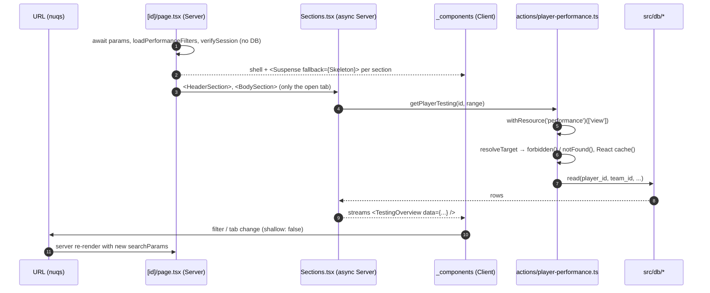

# Development guide

Repo conventions. For the system design, see [Architecture](content/docs/architecture/index.mdx) (`/docs/architecture`).

## UI with server actions

Reference: the player performance page, [`src/app/(protected)/performance/[id]`](<src/app/(protected)/performance/[id]/page.tsx>) with [`actions/player-performance.ts`](src/actions/player-performance.ts).



| Layer     | Location                  | Rules                                                                                                                                   |
| --------- | ------------------------- | --------------------------------------------------------------------------------------------------------------------------------------- |
| Page      | `app/**/page.tsx`         | Server shell; reads params/filters/session only, wraps each data section in `Suspense` + skeleton; `loading.tsx` beside it              |
| Component | `app/**/_components/`     | `'use client'`; forms via `react-hook-form` + schema from `src/schemas/`; feedback via `toaster`                                        |
| Action    | `src/actions/<entity>.ts` | `'use server'`; reads wrap `withAuth`, writes wrap `withResource(resource)(actions, fn)`; return `ResponseFactory`; call `revalidate.*` |
| Data      | `src/db/<entity>.ts`      | Drizzle queries only; no auth, no i18n                                                                                                  |

- `team_id` always comes from the session; ids from the URL are checked against it.
- Map DB errors with `getDbErrorMessage` (constraint names for friendly messages).
- Tests sit next to each file (`*.test.ts(x)`).

## Naming

| What                   | Pattern                                                                                                                                         | Example                                                                   |
| ---------------------- | ----------------------------------------------------------------------------------------------------------------------------------------------- | ------------------------------------------------------------------------- |
| Entity, table, schema  | Singular, PascalCase                                                                                                                            | `TestType`, `TestTypeTable`, `UpsertTestTypeSchema`                       |
| File                   | kebab-case; component `.tsx` files PascalCase                                                                                                   | `actions/test-type.ts`, `use-saved-registrations.ts`, `TestTypeTable.tsx` |
| Action (`src/actions`) | CRUD: `get*`, `upsert*`, `remove*`, `create*`, `update*`; workflows: `submit`, `save`, `send`, `toggle`, `run`, `upload`, `set`; checks: `can*` | `getTestTypes`, `upsertTestType`, `removeTestType`, `submitFeedback`      |
| Data (`src/db`)        | `select*`, `insert*`, `update*`, `delete*`, `upsert*` (multi-row transaction), `count*`, `is*`                                                  | `selectTestTypes`, `insertTestType`, `isCaptain`                          |
| Component              | Singular entity/feature + descriptor; forms start with the action verb                                                                          | `TestTypeTable`, `AssetFilters`, `RosterHeader`, `UpsertTestType`         |
| Route                  | Plural for collections, feature name otherwise                                                                                                  | `/leagues`, `/test-types`; `/attendance`, `/registration`                 |

- Actions and data functions never share a name, so imports need no `as` alias.
- `upsert*` takes an empty id for create; `remove*` is the user-facing delete.
- Enforced by `pnpm lint` via the local plugin [`eslint-rules/naming.mjs`](eslint-rules/naming.mjs): `naming/action-name`, `naming/db-name`, `naming/file-case`, `naming/no-db-alias`. Add a verb there (and here) before using a new one.

Enum suffixes (`src/utils/enum.ts`, lowercase values): `Status` = one-way lifecycle, `State` = any direction, `Condition` = quality.

## Database

```bash
brew services start postgresql@18
pnpm db:generate --name <change>
pnpm db:migrate
```

- Relations: `fields`/`references` on the side that owns the FK; omit them on the other side.
- `'use cache'` + `cacheTag()` only for stable, low-param data with a clear `revalidateTag()` on every write.

## Others

- Avatars stay on Chakra `Avatar.Image` (private blobs → base64, `next/image` gains nothing); use `next/image` for static assets.
- Badges: `surface` + `getColor()` for semantic status, `outline` for neutral labels, `surface` + fixed color for UI accents.
- Chakra snippets: [compositions/ui](https://github.com/chakra-ui/chakra-ui/tree/main/apps/compositions/src/ui).
